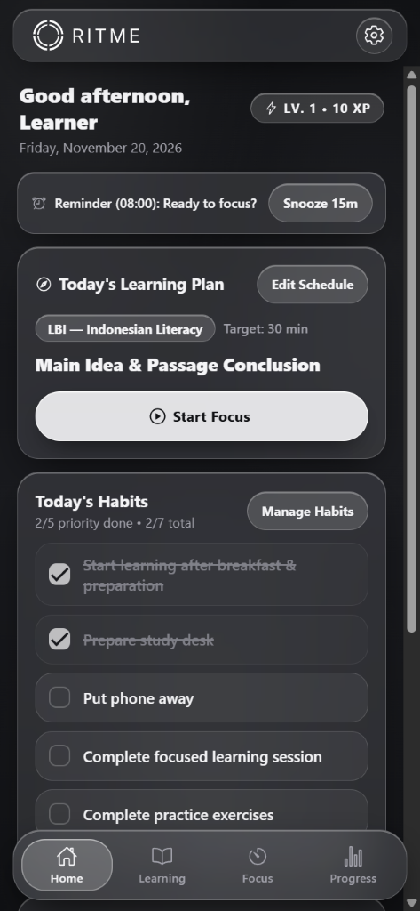
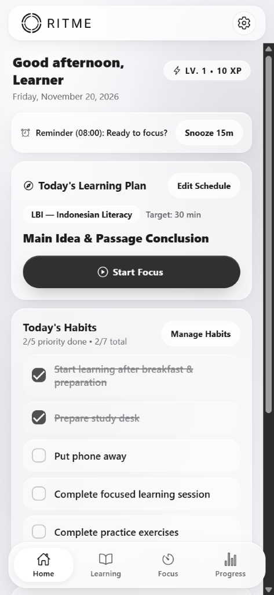
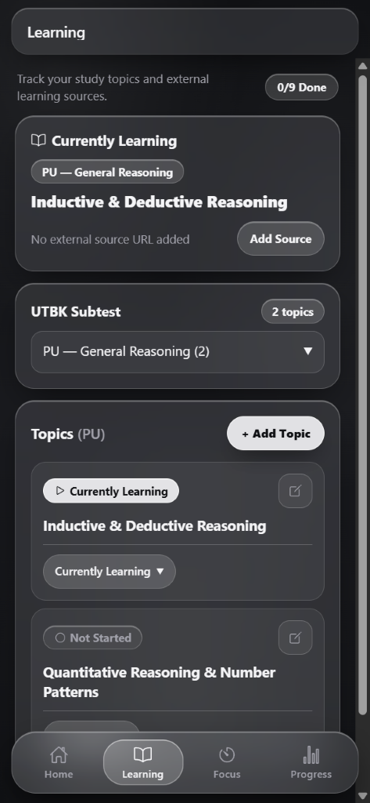
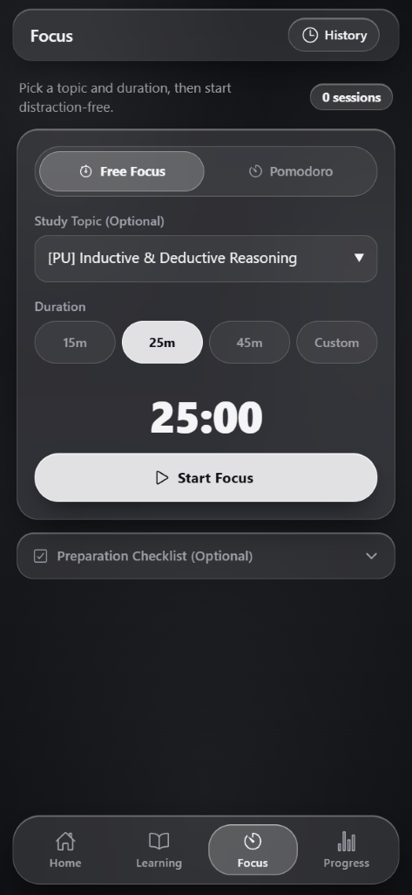
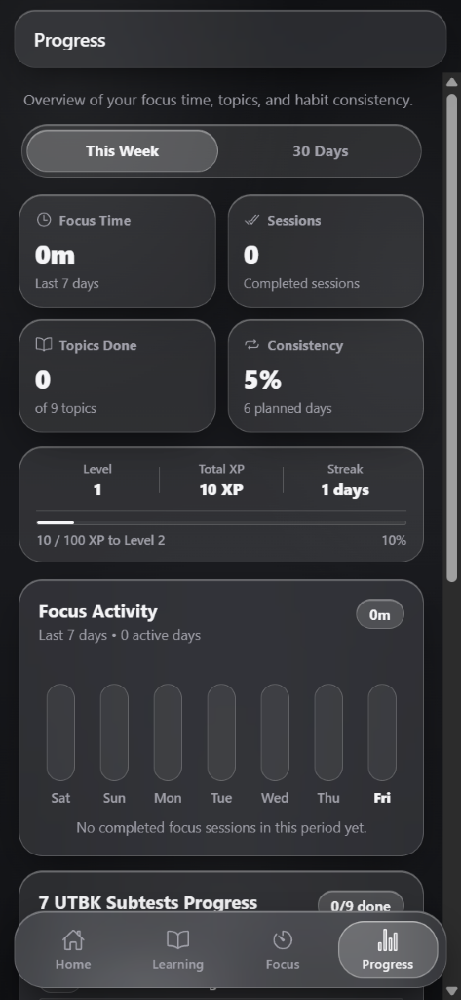
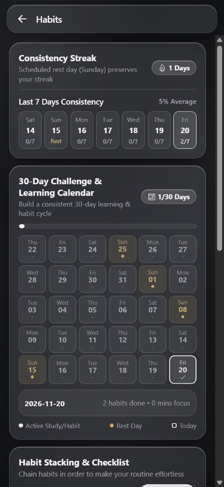
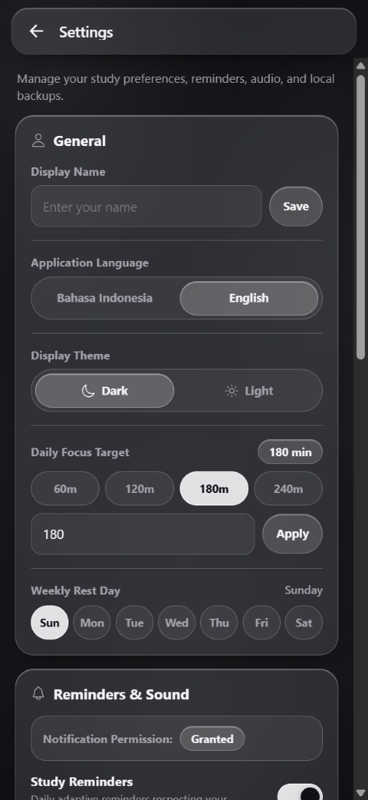
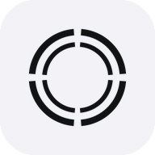
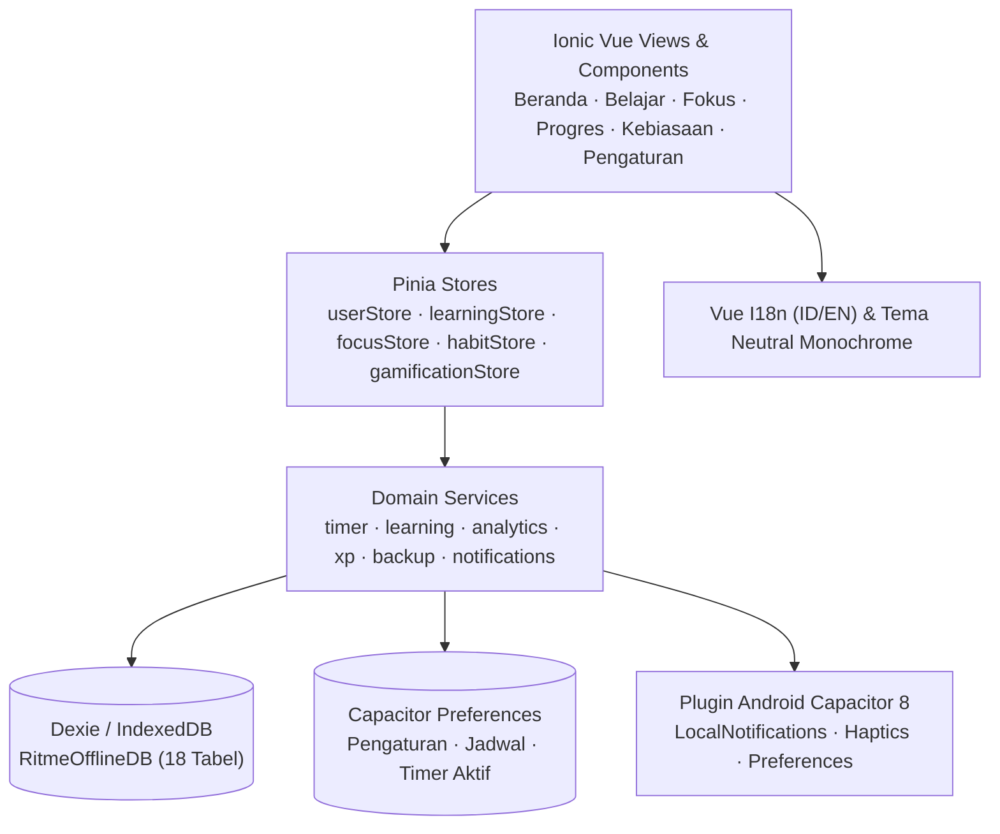

<p align="right">
  <a href="README.md">English</a> | <strong>Bahasa Indonesia</strong>
</p>

<p align="center">
  <picture>
    <source media="(prefers-color-scheme: dark)" srcset="docs/assets/ritme-logo-horizontal-white.svg" />
    <source media="(prefers-color-scheme: light)" srcset="docs/assets/ritme-logo-horizontal-black.svg" />
    
  </picture>
</p>

<h1 align="center">RITME — Personal Learning & Habit Companion</h1>

<p align="center">
  Aplikasi pendamping belajar Android berarsitektur <em>offline-first</em> untuk menjaga konsistensi belajar, mengelola sesi fokus bebas distraksi, dan memantau kebiasaan harian — dirancang dengan sistem visual <strong>Neutral Monochrome Liquid Glass</strong>.
</p>

<p align="center">
  
  
  
  
  
  
  
</p>

---

<p align="center">
  
  &nbsp;&nbsp;&nbsp;
  
</p>

<p align="center">
  <em>Dashboard Beranda — Mode Gelap &amp; Mode Terang (Neutral Monochrome Liquid Glass)</em>
</p>

---

## Ringkasan Proyek

**RITME** adalah aplikasi pendamping belajar personal yang dibangun untuk membantu pelajar mandiri menjaga ritme belajar harian, mengatur blok fokus yang terukur, dan membangun kebiasaan pendukung — sepenuhnya *offline* di perangkat Android.

Banyak aplikasi produktivitas dan belajar dipenuhi struktur LMS yang berat atau mekanik RPG kompleks yang justru mengalihkan perhatian dari proses belajar. RITME mengambil pendekatan yang sengaja sederhana:

- **Tenang & Terfokus:** Navigasi ringkas 4 tab (`Beranda`, `Belajar`, `Fokus`, `Progres`) dengan estetika kaca monokrom netral yang tidak mengganggu konsentrasi.
- **Ritme Harian Praktis:** Menghubungkan rencana belajar harian, timer fokus bebas distraksi, kebiasaan prioritas harian, dan ringkasan progres personal yang jelas.
- **Offline-First & Privat:** Seluruh topik belajar, sesi fokus, kebiasaan, riwayat XP, dan pengaturan tersimpan secara lokal di perangkat memakai Dexie (IndexedDB) dan Capacitor Preferences — lengkap dengan cadangan (backup) & pemulihan JSON tervalidasi.

---

## Tangkapan Layar

| Pelacak Belajar | Timer Fokus | Dashboard Progres |
| :---: | :---: | :---: |
|  |  |  |

| Manajemen Kebiasaan | Pengaturan | Ikon Adaptif Android |
| :---: | :---: | :---: |
|  |  |  |

*(Seluruh tangkapan layar diambil langsung dari build produksi v3.1.0 menggunakan data demonstrasi yang aman.)*

---

## Fitur Utama

### Pelacak Belajar Personal
- Terorganisasi ke dalam **7 subtes UTBK** (`PU`, `PPU`, `PBM`, `PK`, `LBI`, `LBE`, `PM`).
- Tambah, ubah, dan pantau topik materi belajar serta catatan pribadi per subtes.
- Tautan sumber belajar eksternal tervalidasi (hanya `HTTP`/`HTTPS`).
- **3 status belajar sederhana** (`Belum Mulai`, `Sedang Dipelajari`, `Selesai`) dengan kompatibilitas mundur terhadap data 7-status lama.

### Sesi Fokus
- Mendukung mode **Fokus Bebas** dan **Pomodoro** dengan durasi preset (`15m`, `25m`, `45m`) maupun durasi kustom.
- Pemilihan topik terkait dan daftar cek persiapan opsional sebelum mulai.
- **Mode Fokus Zen** bebas distraksi saat timer berjalan.
- Perhitungan timer berbasis *timestamp* dengan pengecualian waktu jeda, pemulihan saat aplikasi kembali dari latar belakang/muat ulang, pemisahan durasi istirahat dari total fokus, serta **Riwayat Fokus** yang dapat difilter.

### Manajemen Kebiasaan
- Daftar kebiasaan harian dengan **maksimal 5 kebiasaan prioritas** yang tampil di Beranda untuk centang 1 ketukan.
- Halaman khusus manajemen kebiasaan (CRUD, urutan prioritas), dukungan hari istirahat mingguan, ringkasan konsistensi mingguan, dan **kalender 30 hari**.

### Pemantauan Progres
- Fokus pada empat metrik personal utama dalam rentang **Minggu Ini** dan **30 Hari**:
  1. **Total Waktu Fokus**
  2. **Sesi Selesai**
  3. **Topik Belajar Selesai**
  4. **Konsistensi Kebiasaan** (memperhitungkan hari istirahat)
- Grafik batang aktivitas fokus, progres per 7 subtes, dan riwayat aktivitas belajar tanpa duplikasi.

### Gamifikasi Ringan
- Sistem motivasi ringan yang dibatasi pada **XP**, **Level**, **Streak**, bar progres menuju level berikutnya, serta umpan balik singkat non-intrusif.
- Pemberian XP idempoten berbasis `eventId`, perlindungan anti-grinding, dan batas harian `100 XP/hari`.

### Personalisasi & Keamanan Data Lokal
- Antarmuka dwibahasa: **Bahasa Indonesia (`id`)** dan **English (`en`)** (`988` kunci terjemahan tersinkron).
- Peralihan tema **Gelap** dan **Terang** secara langsung tanpa muat ulang.
- Pengaturan target fokus harian, hari istirahat mingguan, pengingat belajar adaptif, jam tenang (*quiet hours*), tunda pengingat (*snooze*), nada alarm, dan getaran (*haptics*).
- **Ekspor & Impor Backup JSON** lokal penuh (validasi skema `v1` & `v2` dengan *rollback* lintas penyimpanan) serta reset preferensi selektif khusus kunci RITME.

### Arsitektur Offline-First
- Penyimpanan IndexedDB lokal memakai **Dexie 4** (`RitmeOfflineDB`, 18 tabel dengan migrasi skema non-destruktif `v1` → `v2`).
- Penyimpanan preferensi ringan lewat **Capacitor Preferences**.
- Notifikasi lokal Android untuk pengingat belajar dan selesai timer melalui **Capacitor Local Notifications** dengan small icon monokrom khusus `ritme_notification`.

*(Catatan: RITME dirancang sepenuhnya lokal di perangkat — tidak memiliki sistem akun maupun sinkronisasi cloud.)*

---

## Tumpukan Teknologi

| Lapisan | Teknologi |
|---|---|
| Framework UI | Vue 3 (`^3.5.13`), Ionic Vue (`^8.0.0`), Ionicons (`^7.4.0`) |
| Bahasa & Build | TypeScript (`~5.7.3`), Vite (`^6.2.0`), `vue-tsc` (`^2.2.4`) |
| Routing & State | Vue Router (`^4.5.0`), Pinia (`^3.0.1`) |
| Penyimpanan Lokal | Dexie (`^4.0.11` / IndexedDB), `@capacitor/preferences` (`^8.0.0`) |
| Lokalisasi | Vue I18n (`^11.1.2`) |
| Runtime Native Android | Capacitor 8 (`@capacitor/core`, `@capacitor/android`, `@capacitor/local-notifications`, `@capacitor/haptics`) |
| Toolchain Android | Android SDK (`compileSdk 36`, `targetSdk 36`, `minSdk 24`), Gradle `8.14.3`, Java 21 |
| Pengujian Otomatis | Test runner bawaan Node.js (`node --test`) + `esbuild` |

---

## Ringkasan Arsitektur

RITME memisahkan lapisan tampilan, state reaktif, layanan domain, dan penyimpanan lokal secara modular. Lihat [docs/ARCHITECTURE.md](docs/ARCHITECTURE.md) untuk rincian teknis lengkap.



---

## Struktur Proyek

```text
.
├── .github/workflows/       # Workflow CI GitHub Actions untuk tes regresi & build produksi web
├── android/                 # Proyek native Android Capacitor 8 (Gradle, manifest, ikon adaptif & notifikasi)
├── docs/
│   ├── assets/              # Aset SVG brand resmi RITME, pratinjau ikon launcher, social preview
│   ├── screenshots/         # Tangkapan layar aplikasi v3.1.0 terkurasi
│   ├── ARCHITECTURE.md      # Rincian arsitektur, tanggung jawab store/service & skema Dexie
│   └── DEVELOPMENT.md       # Panduan instalasi, skrip, pengujian & build APK Android
├── scripts/
│   └── android-apk.mjs      # Skrip bantu build web, sync Capacitor, kompilasi APK & adb run
├── src/
│   ├── assets/brand/        # Logo horizontal SVG resmi untuk HomePage.vue
│   ├── components/          # Komponen UI modular per domain (dashboard, learning, focus, progress, habits, settings)
│   ├── i18n/                # File lokalisasi dwibahasa (id.json, en.json) dan konfigurasi Vue I18n
│   ├── router/              # Rute navigasi 4 tab dan redirect kompatibilitas rute lama
│   ├── services/            # Database (Dexie), backup/rollback, timer, analitik, notifikasi, XP & pelacak belajar
│   ├── stores/              # Pinia store (user, learning, focus, habit, gamification)
│   ├── theme/               # Token desain Neutral Monochrome Liquid Glass & gaya bar melayang
│   ├── types/               # Definisi tipe TypeScript bersama
│   ├── utils/               # Utilitas tanggal lokal dan generator ID
│   └── views/               # Halaman utama (Home, Learning, Focus, Progress, Habits, Settings, Onboarding)
├── tests/
│   └── ritme-regression.test.mjs   # 22 uji regresi offline
├── capacitor.config.ts      # Konfigurasi appId Capacitor, webDir, dan smallIcon LocalNotifications
├── CHANGELOG.md             # Catatan tonggak versi (v3.1.0)
├── package.json             # Daftar dependensi dan skrip build/tes/Android terverifikasi
└── vite.config.ts           # Konfigurasi Vite dan manual chunking Rollup
```

---

## Instalasi & Pengembangan

Lihat [docs/DEVELOPMENT.md](docs/DEVELOPMENT.md) untuk prasyarat lengkap termasuk konfigurasi Android SDK & JDK 21.

```bash
# 1. Clone repositori
git clone https://github.com/danaragaa/ritme-personal-learning-habit-companion.git
cd ritme-personal-learning-habit-companion

# 2. Pasang dependensi sesuai package-lock.json
npm ci

# 3. Jalankan server pengembangan web Vite
npm run dev

# 4. Jalankan rangkaian uji regresi offline (22 tes)
npm test

# 5. Jalankan pemeriksaan TypeScript dan build web produksi
npm run build

# 6. Build bundle web dan sinkronisasi proyek Android Capacitor
npm run android:sync

# 7. Kompilasi Android Debug APK (membutuhkan JDK 21 + Android SDK API 36 + android/local.properties)
npm run android:apk
```

---

## Status Proyek

| Aspek | Status |
|---|---|
| **Versi Saat Ini** | `3.1.0` (`versionCode: 2`, `com.ritme.app`) |
| **Platform Target** | Android (`minSdk 24`, `compileSdk 36`, `targetSdk 36`) |
| **Tujuan Penggunaan** | Proyek pendamping belajar personal & portofolio rekayasa perangkat lunak |
| **Implementasi Inti & QA Web** | Selesai (`22/22` uji regresi lulus, build produksi web lulus) |
| **Build Debug APK** | Selesai (`android/app/build/outputs/apk/debug/app-debug.apk`, tidak dimasukkan ke Git) |
| **QA Perangkat Fisik Android** | **Tertunda (Pending)** — verifikasi langsung pada perangkat Android fisik untuk masking ikon launcher, ikon notifikasi, alarm latar belakang, dan *safe-area* belum dijalankan |

---

## Sorotan Pengembangan

- **Navigasi 4 Tab:** Penyederhanaan alur harian ke `Beranda`, `Belajar`, `Fokus`, dan `Progres`, dilengkapi halaman khusus `Kebiasaan` dan `Pengaturan`.
- **Sistem Desain Neutral Monochrome Liquid Glass:** Token permukaan gelap/terang terpusat, Floating Glass Appbar compact `48px`, bilah navigasi kapsul melayang, serta ikonografi Ionicons tanpa emoji.
- **Redesain Pelacak Belajar:** Penyederhanaan status belajar menjadi 3 status kanonik dengan tetap menjaga kompatibilitas data lama dan validasi tautan eksternal.
- **Timer Fokus Berbasis Timestamp:** Menghitung durasi aktual dari *timestamp* sistem dengan mengecualikan waktu jeda dan pulih otomatis setelah aplikasi ditutup atau masuk latar belakang.
- **Migrasi Dexie Non-Destruktif (`v1` → `v2`):** Mempertahankan seluruh 18 tabel lokal IndexedDB tanpa merusak histori data lama.
- **Validasi Backup & Rollback Lintas Penyimpanan:** Memvalidasi skema JSON backup `v1` dan `v2` sebelum menulis ulang data, serta mengembalikan state Dexie & Preferences bila terjadi kegagalan di tengah proses impor.
- **Reset Preferensi Selektif:** Hanya menghapus kunci berawalan `ritme_` dan kunci daftar cek harian dinamis tanpa mengganggu kunci lain di penyimpanan.
- **Gamifikasi Ringan:** Mengganti sistem RPG berat dengan XP idempoten, batas harian (`100 XP`), level terukur, dan streak yang menghargai hari istirahat.
- **Integrasi Identitas Merek & Notifikasi Android:** Mengintegrasikan ikon launcher adaptif Paced Ring (termasuk layer monokrom Android 13+) serta small icon notifikasi `ritme_notification` memakai API resmi Capacitor 8.
- **Lokalisasi Dwibahasa & Uji Regresi:** Menjaga sinkronisasi `988/988` kunci ID/EN serta `22` tes regresi otomatis offline.

---

## Rencana Penyempurnaan

- Menjalankan QA langsung di perangkat fisik Android lintas produsen dan versi OS.
- Memvalidasi ketepatan pengiriman notifikasi lokal dan siklus hidup timer di bawah kebijakan penghematan baterai / Doze Android.
- Memverifikasi jarak *safe-area* status bar dan navigasi gestur pada layar fisik ber-notch/punch-hole.
- Melakukan pengujian aksesibilitas tambahan termasuk pembaca layar TalkBack Android.
- Menyempurnakan ergonomi harian berdasarkan pemakaian personal nyata serta menyiapkan build *release* bertanda tangan setelah QA fisik selesai.

---

## Pemberitahuan Lisensi

Repositori ini belum menetapkan lisensi *open-source* secara eksplisit. Seluruh hak cipta tetap dimiliki oleh penulis; repositori ini dipublikasikan untuk keperluan peninjauan portofolio dan demonstrasi publik.
