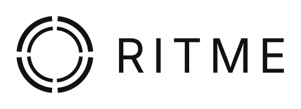
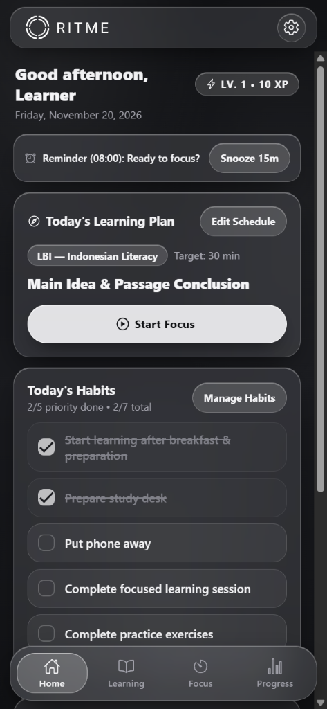
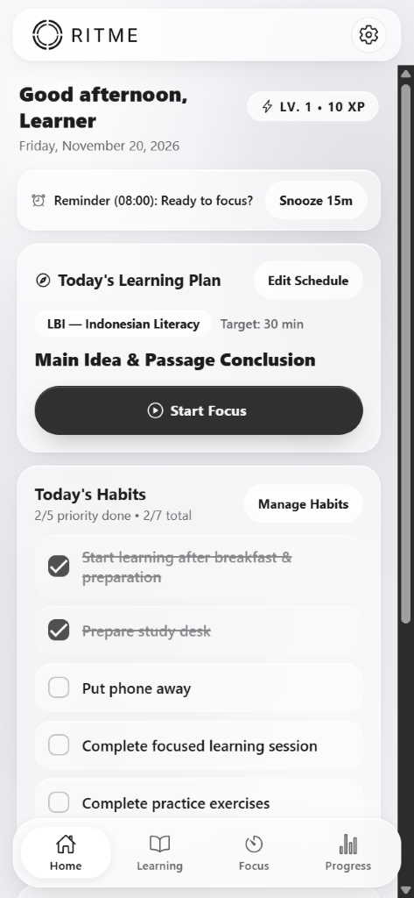
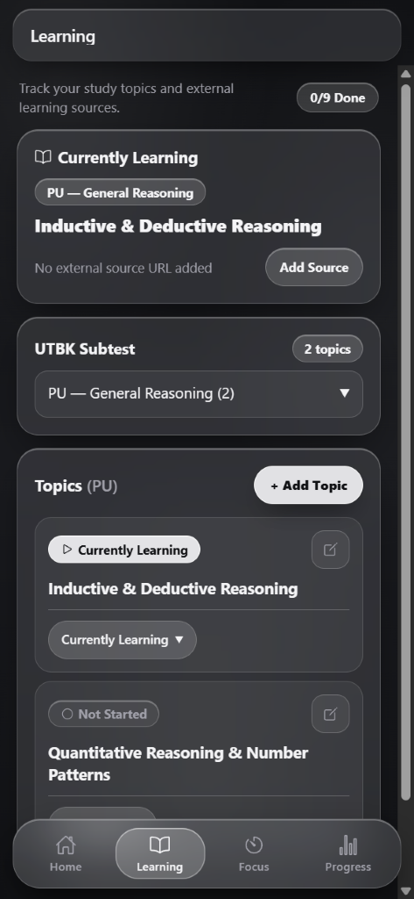
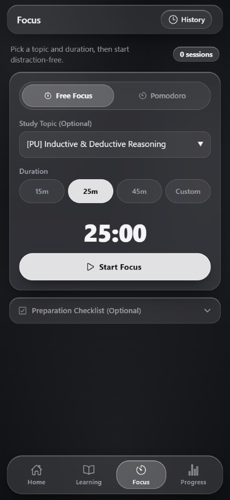
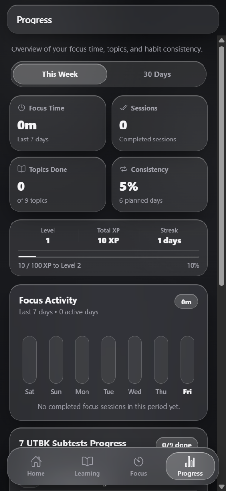
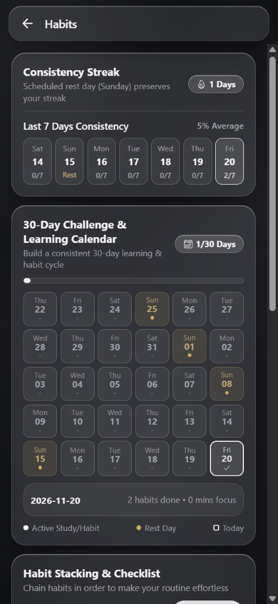
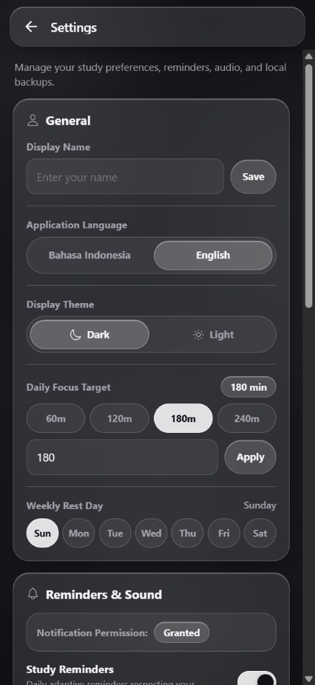
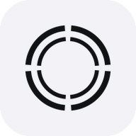
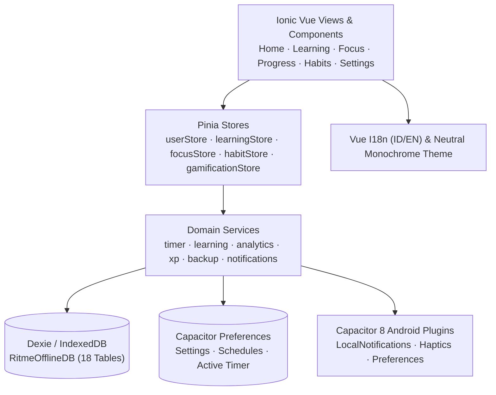

<p align="right">
  <strong>English</strong> | <a href="README.id.md">Bahasa Indonesia</a>
</p>

<p align="center">
  <picture>
    <source media="(prefers-color-scheme: dark)" srcset="docs/assets/ritme-logo-horizontal-white.svg" />
    <source media="(prefers-color-scheme: light)" srcset="docs/assets/ritme-logo-horizontal-black.svg" />
    
  </picture>
</p>

<h1 align="center">RITME — Personal Learning & Habit Companion</h1>

<p align="center">
  An offline-first Android companion for maintaining learning consistency, managing distraction-free focus sessions, and tracking daily habits — designed with a calm <strong>Neutral Monochrome Liquid Glass</strong> interface.
</p>

<p align="center">
  
  
  
  
  
  
  
</p>

---

<p align="center">
  
  &nbsp;&nbsp;&nbsp;
  
</p>

<p align="center">
  <em>Home Dashboard — Dark Mode &amp; Light Mode (Neutral Monochrome Liquid Glass)</em>
</p>

---

## Project Overview

**RITME** is a personal mobile companion built to help independent learners stay consistent with their daily study routine, structure focused study blocks, and track supporting daily habits — entirely offline on Android.

Many study and productivity apps grow noisy with heavy LMS hierarchies, social feeds, or RPG mechanics that compete with actual study time. RITME takes the opposite approach:

- **Calm & Focused:** A minimal 4-tab navigation (`Home`, `Learning`, `Focus`, `Progress`) with a monochrome frosted-glass aesthetic that stays out of the way.
- **Practical Daily Rhythm:** Connects today's planned study subtest, a distraction-free focus timer, daily priority habits, and a clear personal progress summary.
- **Offline-First & Private:** All study topics, sessions, habits, XP transactions, and settings live locally on the device via Dexie (IndexedDB) and Capacitor Preferences — with versioned JSON backup export/import.

---

## Screenshots

| Learning Tracker | Focus Timer | Progress Dashboard |
| :---: | :---: | :---: |
|  |  |  |

| Habit Management | Settings | Android Adaptive Icon |
| :---: | :---: | :---: |
|  |  |  |

*(All screenshots are captured directly from the v3.1.0 production web bundle using safe demonstration data.)*

---

## Core Features

### Personal Learning Tracker
- Organized around **7 UTBK subtests** (`PU`, `PPU`, `PBM`, `PK`, `LBI`, `LBE`, `PM`).
- Create, edit, and track personal study topics and notes per subtest.
- Attach validated external learning source links (`HTTP`/`HTTPS` only).
- **3 simple learning states** (`Not Started`, `In Progress`, `Completed`) with backward compatibility for legacy 7-status records.

### Focus Sessions
- Supports **Free Focus** and **Pomodoro** modes with preset (`15m`, `25m`, `45m`) and custom durations.
- Optional topic association and collapsible pre-session preparation checklist.
- Distraction-free **Zen Focus Mode** while a session is running.
- Timestamp-based session engine with pause/resume time exclusion, background/reload recovery, break exclusion from focus totals, and filterable **Focus History**.

### Habit Management
- Daily habit checklist with **up to 5 priority habits** surfaced directly on Home for 1-tap completion.
- Dedicated habit management view for CRUD, ordering, weekly rest-day preservation, weekly consistency summary, and a **30-day calendar** history.

### Progress Monitoring
- Centered on four clear personal metrics across **This Week** and **30 Days** windows:
  1. **Total Focus Time**
  2. **Completed Sessions**
  3. **Completed Learning Topics**
  4. **Habit Consistency** (rest-day aware)
- Focus activity bar chart, 7-subtest completion breakdown, and deduplicated learning activity history.

### Lightweight Gamification
- Simple motivational feedback limited to **XP**, **Level**, **Streak**, next-level progress bar, and brief non-intrusive toast feedback.
- Idempotent XP awards keyed by `eventId`, anti-grinding guards, and a `100 XP/day` daily cap.

### Personalization & Data Control
- Bilingual interface: **Indonesian (`id`)** and **English (`en`)** (`988` synchronized translation keys).
- Reactive **Dark Mode** and **Light Mode** theme switching.
- Configurable daily focus targets, weekly rest day, adaptive study reminders, quiet hours, reminder snooze, audio alarm tones, and haptics.
- Full local JSON **Backup Export & Import** (`v1` & `v2` schema validation with cross-storage rollback) plus selective RITME preferences reset.

### Offline-First Local Storage
- Local IndexedDB storage managed by **Dexie 4** (`RitmeOfflineDB`, 18 tables with non-destructive `v1` → `v2` schema migration).
- Lightweight key-value persistence via **Capacitor Preferences**.
- Native Android local reminders and timer completion notifications via **Capacitor Local Notifications** using the custom monochrome `ritme_notification` small icon.

*(Note: RITME is strictly local-only by design — there is no user account system or cloud synchronization.)*

---

## Technology Stack

| Layer | Technology |
|---|---|
| UI Framework | Vue 3 (`^3.5.13`), Ionic Vue (`^8.0.0`), Ionicons (`^7.4.0`) |
| Language & Build | TypeScript (`~5.7.3`), Vite (`^6.2.0`), `vue-tsc` (`^2.2.4`) |
| Routing & State | Vue Router (`^4.5.0`), Pinia (`^3.0.1`) |
| Local Persistence | Dexie (`^4.0.11` / IndexedDB), `@capacitor/preferences` (`^8.0.0`) |
| Localization | Vue I18n (`^11.1.2`) |
| Native Android Runtime | Capacitor 8 (`@capacitor/core`, `@capacitor/android`, `@capacitor/local-notifications`, `@capacitor/haptics`) |
| Android Toolchain | Android SDK (`compileSdk 36`, `targetSdk 36`, `minSdk 24`), Gradle `8.14.3`, Java 21 |
| Automated Testing | Node.js built-in test runner (`node --test`) + `esbuild` test harness |

---

## Architecture Overview

RITME separates presentation, reactive state, domain services, and local persistence into focused layers. See [docs/ARCHITECTURE.md](docs/ARCHITECTURE.md) for the full technical breakdown.



---

## Project Structure

```text
.
├── .github/workflows/       # GitHub Actions web build & regression test CI
├── android/                 # Capacitor 8 Android project (Gradle, manifest, adaptive & notification icons)
├── docs/
│   ├── assets/              # Official RITME SVG brand lockups, launcher icon preview, social preview
│   ├── screenshots/         # Curated v3.1.0 application screenshots
│   ├── ARCHITECTURE.md      # Technical architecture, stores, services & Dexie schema overview
│   └── DEVELOPMENT.md       # Local setup, scripts, testing & Android APK build instructions
├── scripts/
│   └── android-apk.mjs      # Helper CLI for web build, Capacitor sync, Gradle APK build & adb run
├── src/
│   ├── assets/brand/        # Official horizontal SVG logos used by HomePage.vue
│   ├── components/          # Modular UI components grouped by domain (dashboard, learning, focus, progress, habits, settings)
│   ├── i18n/                # Bilingual locale files (id.json, en.json) and Vue I18n setup
│   ├── router/              # Four-tab navigation routes and legacy compatibility redirects
│   ├── services/            # Database (Dexie), backup/rollback, timer, analytics, notifications, XP & learning services
│   ├── stores/              # Pinia state stores (user, learning, focus, habit, gamification)
│   ├── theme/               # Neutral Monochrome Liquid Glass tokens and floating bar styles
│   ├── types/               # Shared TypeScript interfaces
│   ├── utils/               # Local date key utilities and ID generators
│   └── views/               # Page views (Home, Learning, Focus, Progress, Habits, Settings, Onboarding)
├── tests/
│   └── ritme-regression.test.mjs   # 22 offline regression tests
├── capacitor.config.ts      # Capacitor app ID, webDir, and LocalNotifications smallIcon config
├── CHANGELOG.md             # Milestone changelog (v3.1.0)
├── package.json             # Dependencies and verified build/test/Android scripts
└── vite.config.ts           # Vite & Rollup manual chunking configuration
```

---

## Installation & Development

See [docs/DEVELOPMENT.md](docs/DEVELOPMENT.md) for complete prerequisites (including Android SDK & JDK 21 configuration).

```bash
# 1. Clone the repository
git clone https://github.com/danaragaa/ritme-personal-learning-habit-companion.git
cd ritme-personal-learning-habit-companion

# 2. Install dependencies from package-lock.json
npm ci

# 3. Start the Vite web development server
npm run dev

# 4. Run the offline regression test suite (22 tests)
npm test

# 5. Run TypeScript check and production web build
npm run build

# 6. Build web bundle and synchronize Capacitor Android
npm run android:sync

# 7. Compile the Android Debug APK (requires JDK 21 + Android SDK API 36 + android/local.properties)
npm run android:apk
```

---

## Project Status

| Aspect | Status |
|---|---|
| **Current Version** | `3.1.0` (`versionCode: 2`, `com.ritme.app`) |
| **Target Platform** | Android (`minSdk 24`, `compileSdk 36`, `targetSdk 36`) |
| **Intended Usage** | Personal-use companion & engineering portfolio project |
| **Core Implementation & Web QA** | Completed (`22/22` regression tests passing, production web build passing) |
| **Debug APK Build** | Completed (`android/app/build/outputs/apk/debug/app-debug.apk`, excluded from Git) |
| **Physical Android Device QA** | **Pending** — real handset verification of launcher icon masking, notification tray icon, background alarms, and safe areas has not yet been executed |

---

## Development Highlights

- **Four-Tab Navigation Architecture:** Consolidated daily workflows into `Home`, `Learning`, `Focus`, and `Progress`, paired with dedicated `Habits` and `Settings` views.
- **Neutral Monochrome Liquid Glass Design System:** Built centralized dark/light surface tokens, a compact `48px` floating glass Appbar, floating capsule bottom navigation, and zero-emoji Ionicons iconography.
- **Learning Tracker Redesign:** Simplified 7-status tracking into 3 canonical states while maintaining full compatibility with existing stored records and validated external URLs.
- **Timestamp-Based Focus Timer:** Calculates elapsed focus duration from wall-clock timestamps excluding paused periods, recovering cleanly across background suspensions and reloads.
- **Non-Destructive Dexie Migration (`v1` → `v2`):** Preserves all 18 local IndexedDB tables without breaking historical data.
- **Backup Validation & Cross-Storage Rollback:** Validates `v1` and `v2` backup JSON structures prior to write and restores prior Dexie & Preferences state if a mid-import error occurs.
- **Selective Preferences Reset:** Clears only `ritme_`-prefixed keys and dynamic daily checklist keys without touching unrelated Capacitor storage keys.
- **Lightweight Gamification:** Replaced heavy RPG mechanics with idempotent XP, daily cap (`100 XP`), level thresholds, and rest-day-aware streak tracking.
- **Native Android Brand & Notification Integration:** Integrated official Paced Ring adaptive launcher icons (including Android 13+ monochrome layer) and the `ritme_notification` small icon through Capacitor 8 APIs.
- **Bilingual Localization & Regression Safety:** Maintained `988/988` Indonesian/English keys and `22` automated offline regression tests.

---

## Future Improvements

- Execute physical Android device QA across multiple manufacturers and Android versions.
- Validate background timer alarm reliability and local notification delivery under Android Doze / battery optimization policies.
- Verify status bar and gesture-navigation safe-area spacing on physical notch/punch-hole displays.
- Perform additional screen-reader and contrast accessibility testing on Android TalkBack.
- Refine day-to-day UX ergonomics based on sustained real-world personal use and prepare signed release builds after physical QA passes.

---

## License Notice

No explicit open-source license has been assigned to this repository. All rights remain reserved by the author; this repository is published for public portfolio review and demonstration purposes.
