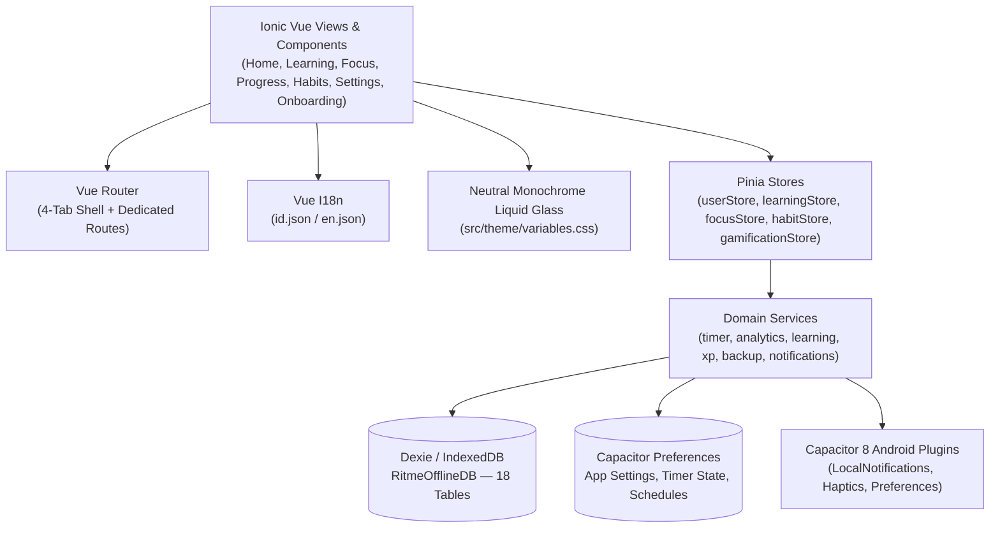

# RITME Architecture Overview

**Version:** `3.1.0` (`com.ritme.app`, `versionCode 2`)  
**Stack:** Vue 3.5 · Ionic Vue 8 · TypeScript 5.7 · Pinia 3 · Dexie 4 (IndexedDB) · Capacitor 8 · Vue I18n 11

RITME is designed as an **offline-first** single-page application bundled with Vite and wrapped for Android using Capacitor 8. All user data resides locally on the device with no external backend or cloud account dependency.

---

## 1. High-Level System Architecture

---

## 2. Routing & View Layer (`src/views/`, `src/router/index.ts`)

- **Tab Shell (`TabsLayout.vue`):**
  - `/tabs/home` → `HomePage.vue` (official brand lockup Appbar, greeting, today's learning plan, priority habits, daily progress summary)
  - `/tabs/learning` → `LearningPage.vue` (7 UTBK subtests, topic tracker, status filters, add/edit modal)
  - `/tabs/focus` → `FocusPage.vue` (Free Focus & Pomodoro modes, Zen Focus view during active sessions, history modal)
  - `/tabs/progress` → `ProgressPage.vue` (4 personal metrics, period selector, focus activity chart, subtest progress, activity history)
- **Dedicated Pages:**
  - `/habits` → `HabitsPage.vue` (habit CRUD, priority ordering, 30-day calendar, weekly consistency)
  - `/settings` → `SettingsPage.vue` (General, Reminders & Sound, Data Management, About RITME)
  - `/onboarding` → `OnboardingPage.vue` (first-launch personal setup)
- **Legacy Compatibility Redirects:**
  - `/tabs/habits` → `/habits`
  - `/rewards` → `/tabs/progress`

---

## 3. Pinia Store Responsibilities (`src/stores/`)

| Store | Primary Responsibility |
|---|---|
| `userStore.ts` | Manages `UserSettings`, display name, language (`id`/`en`), theme (`dark`/`light`), daily focus targets, weekly rest day, weekly study schedule, reminder times, snooze state, audio/haptics flags, and immediate DOM theme application. |
| `learningStore.ts` | Manages the 7 UTBK `subtestCategories` and personal `learningTopics` (CRUD, canonical 3-status mapping with legacy 7-status compatibility, validated external URLs, completion timestamps) plus legacy study data hydration for backup/migration integrity. |
| `focusStore.ts` | Controls timestamp-based focus sessions (`Free Focus` and `Pomodoro`), pause/resume tracking, background & app-reload recovery, completion/cancellation lifecycle, session persistence, break exclusion from focus totals, and timer completion notification hooks. |
| `habitStore.ts` | Manages daily habits, priority ordering (max 5 highlighted on Home), daily completion toggles, rest-day-aware streak calculation, and 30-day habit history. |
| `gamificationStore.ts` | Lightweight XP & level progression engine: awards idempotent XP per unique `eventId`, enforces a daily XP cap (`100 XP/day`), tracks level thresholds and level-up events, and drives the compact toast feedback overlay (`GamificationFeedbackOverlay.vue`). |

---

## 4. Domain Services (`src/services/`)

- **Database (`database/db.ts`):** Defines `RitmeDatabase` (`RitmeOfflineDB`) using Dexie 4 with non-destructive version `1` → `2` schema migration across 18 tables.
- **Learning (`learning/learningTrackerService.ts`, `masteryEngine.ts`, `adventureContentSeed.ts`):** Canonical status normalization (`not_started`, `in_progress`, `completed`), logical topic sorting, HTTP/HTTPS URL validation, and deterministic subtest seed records.
- **Timer & Feedback (`timer/focusTimerService.ts`, `soundFeedbackService.ts`):** Persists active timer checkpoints in Capacitor Preferences for accurate elapsed-time recovery across app suspensions; provides Web Audio tones and `@capacitor/haptics` feedback respecting silent/vibration settings.
- **Analytics (`analytics/progressSummaryService.ts`, `learningAnalytics.ts`, `productivityAnalytics.ts`):** Aggregates 7-day / 30-day focus minutes (excluding cancelled and break sessions), completed session counts, completed learning topics across 7 subtests, deduplicated activity history, and rest-day-aware habit consistency.
- **XP & Levels (`xp/levelConfigService.ts`):** Normalizes level threshold tables and computes current level / next-level progress.
- **Backup & Recovery (`backup/backupSchema.ts`, `backupService.ts`):** Exports all 18 Dexie tables plus RITME Preferences into versioned JSON (`schemaVersion: 2`), validates both `v1` and `v2` payloads before importing, performs cross-storage rollback if a mid-import Preferences write fails, and runs selective RITME-prefixed key cleanup on app reset.
- **Notifications (`notifications/localNotificationService.ts`):** Manages Android notification channels (`ritme_reminders`, `ritme_timer_alarm`), permission queries, overnight quiet hours, rest-day skipping, snooze scheduling, and official `ritme_notification` small icon configuration.

---

## 5. Local Database Overview (`RitmeOfflineDB`)

`src/services/database/db.ts` declares **18 Dexie tables** across schema `v1` and `v2` (upgraded non-destructively so existing user data is preserved):

- **Core Active Tables:** `userSettings`, `habits`, `habitCompletions`, `studySessions`, `subtestCategories`, `learningTopics`, `xpTransactions`, `dailyReflections`
- **Legacy-Preserved Tables (kept intact for schema & backup compatibility):** `achievements`, `personalRewards`, `rewardRedemptions`, `chapters`, `questions`, `questionAttempts`, `mistakeNotes`, `customQuests`, `bossAttempts`, `mockTests`

Key persistence invariants:
- `xpTransactions` enforces a unique `&eventId` index for idempotent XP awards.
- `habitCompletions` indexes `[habitId+date]` using local calendar dates (`YYYY-MM-DD`).
- `dailyReflections` enforces a unique `&date` index.

---

## 6. Localization & Theme Architecture

- **Localization (`src/i18n/`):** Powered by `vue-i18n` (`id.json` and `en.json`, `988` synchronized keys each). Language preference is cached for instant boot hydration and synced to Dexie + Capacitor Preferences.
- **Theme Management (`src/theme/variables.css`, `src/stores/userStore.ts`):**
  - Default theme is Dark Mode (`#101114` neutral graphite canvas); Light Mode applies `.theme-light` on `:root` (`#F2F2F7` frosted surface).
  - Centralized CSS custom properties control glass translucency, hairline borders, typography, floating `48px` Appbar, floating capsule tab bar, and modal sheets.
  - The Home Appbar SVG logo reacts directly to `userStore.settings.theme` without introducing a separate theme store.

---

## 7. Capacitor 8 Android Integration

- **Config (`capacitor.config.ts`):** `appId: 'com.ritme.app'`, `appName: 'RITME'`, `webDir: 'dist'`, `server.androidScheme: 'https'`, and `plugins.LocalNotifications.smallIcon: 'ritme_notification'`.
- **Android Native Project (`android/`):**
  - `compileSdkVersion = 36`, `targetSdkVersion = 36`, `minSdkVersion = 24`, `versionName = "3.1.0"`, `versionCode = 2`.
  - Uses Gradle `8.14.3` wrapper and Java 21 toolchain (`capacitor.build.gradle`).
  - Official Paced Ring adaptive launcher icon (`mipmap-anydpi-v26/ic_launcher.xml`, `ic_launcher_round.xml`, `drawable/ritme_launcher_foreground.xml`, `drawable/ritme_launcher_monochrome.xml`, `values/colors.xml`, and `mdpi`–`xxxhdpi` fallback PNGs).
  - Transparent monochrome notification small icon (`drawable/ritme_notification.xml`, `24dp × 24dp`).
  - Installed native plugins: `@capacitor/haptics@8.0.2`, `@capacitor/local-notifications@8.3.1`, `@capacitor/preferences@8.0.1`.
